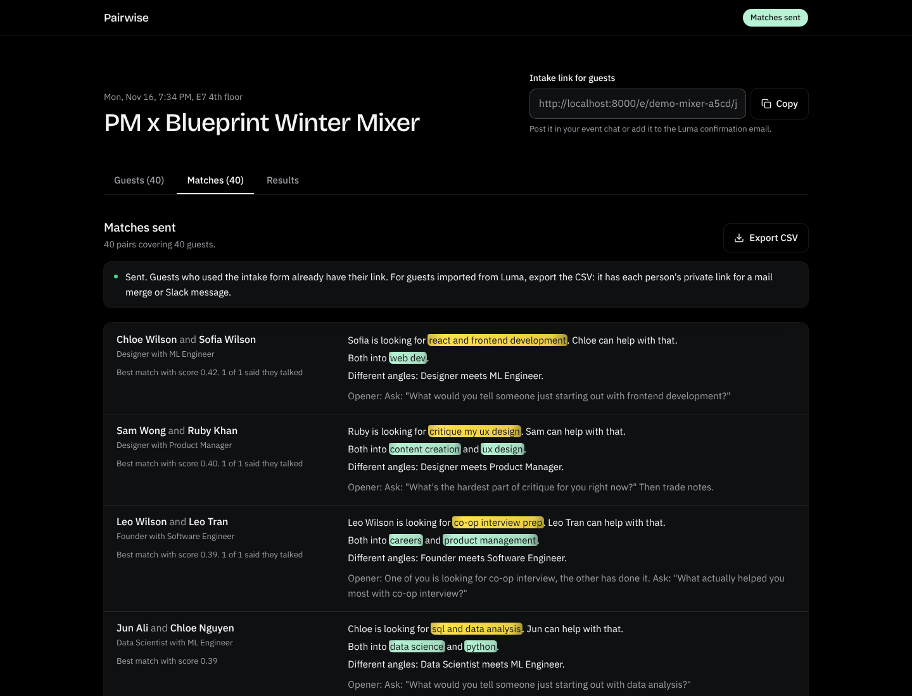
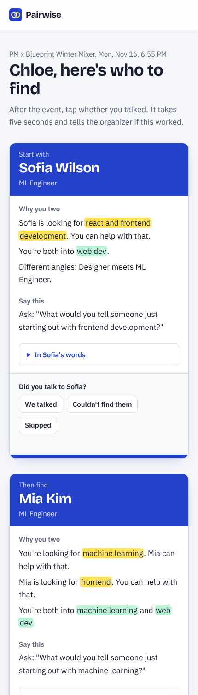
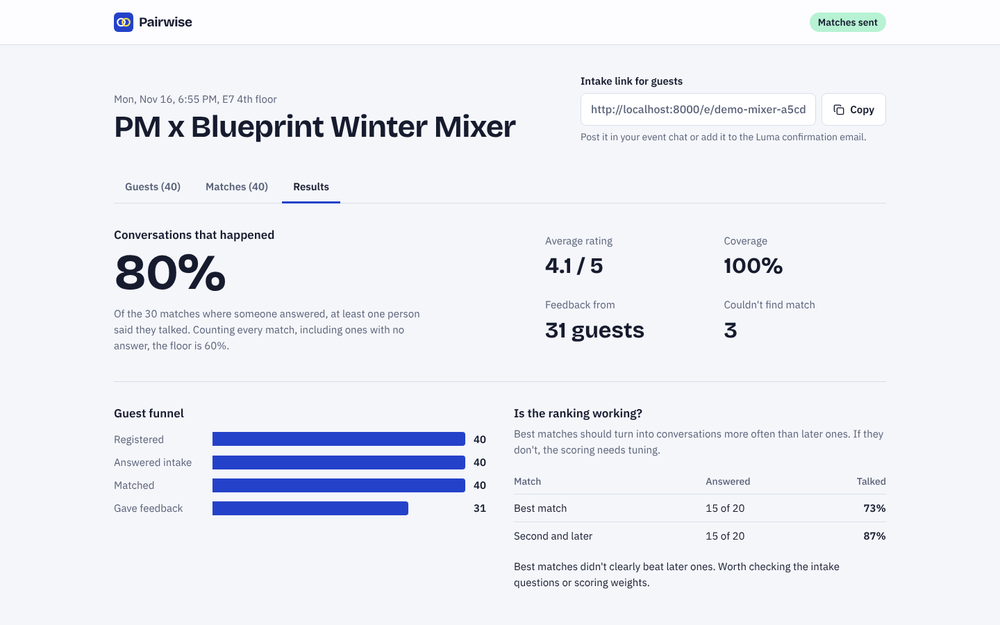
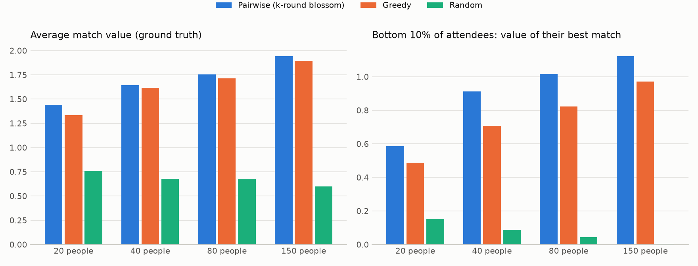

# Pairwise

**Tell everyone at your event who to meet, and why.**

Pairwise is an open-source matchmaker for student club events. Guests answer a 60-second form. Pairwise gives each of them two or three people to find, the exact words that connected them, and an opener. After the event, guests tap whether they talked, and the organizer sees how many conversations actually happened.

It's an open-source take on [Bubble Lab](https://bubblelab.ai) (YC W26), rebuilt for clubs with no budget: no sales demo, no paid tier, no LinkedIn scraping.



<table>
<tr>
<td width="34%"></td>
<td><br><sub>Results use simulated feedback from the demo seed. Real numbers come from the <a href="docs/LIVE_TEST.md">live test</a>.</sub></td>
</tr>
</table>

---

## Why I built this

I run events for UW Blueprint and UW Product Management. The same thing happens every time: people show up, find the two friends they came with, and leave. We count RSVPs. We never find out whether anyone met someone new.

Bubble Lab solves this for professional communities, but it starts at $99/mo behind a "Book a demo" button. A student club can't use it. So I built the version a club can: free, self-serve, and measurable.

| | |
|---|---|
| **Product** | [PRD](docs/PRD.md): problem, users, flows, success metrics, scope, non-goals |
| **Engineering** | [Design doc](docs/DESIGN.md): architecture, data model, matching algorithm options and trade-offs |
| **Evidence** | [Benchmark](docs/BENCHMARK.md): matching vs greedy and random baselines on data with known ground truth |
| **Next** | [Live test plan](docs/LIVE_TEST.md) with hypotheses and pass criteria, [roadmap](docs/ROADMAP.md) |

## How it works

1. **Organizer** creates an event, imports the Luma guest CSV and/or shares an intake link.
2. **Guests** answer: interests, what they're looking for, what they can help with.
3. **Pairwise** scores every pair, solves the matching, and explains each pair with evidence.
4. **Organizer** reviews the pairs (the highlighted words make bad matches obvious) and sends.
5. **Guests** open their private link at the event. The next day they tap "We talked" and rate it.
6. **Organizer** sees conversation rate, rating, coverage, and whether best matches beat later ones.

## The matching engine

The interesting part lives in [`backend/pairwise/matching/`](backend/pairwise/matching). Each stage is a pure function with its own tests.

**1. Encode.** Every text field for an event goes through one TF-IDF model fit on that event's own vocabulary, so one person's "looking for" and another's "can help with" sit in the same vector space. A custom analyzer keeps bigrams inside list items (so "SQL, data analysis" never invents "sql data") and drops framing words like "learning" or "advice" as unigrams while keeping them inside phrases like "machine learning". An OpenAI-compatible embeddings encoder can be swapped in behind the same `TextEncoder` protocol.

**2. Score.** For each pair:

```
help(i←j)  = cos(looking_for_i, can_help_with_j)
score(i,j) = 0.55 · mean(help(i←j), help(j←i))     # value in both directions
           + 0.35 · shared interests                 # Jaccard on tags + cosine
           + 0.10 · different roles
           − 0.50 · same club/team                   # they probably already know each other
```

**3. Solve.** Giving everyone *k* distinct matches is maximum-weight *b*-matching. Pairwise runs *k* rounds of Edmonds' blossom algorithm (max-cardinality, max-weight), removing used pairs each round, then repairs odd headcounts by attaching whoever sat out to their best available partner. Invariants are tested across random sizes: no duplicates, nobody left out, nobody over *k*+1.

**4. Explain.** A dot product is a sum of per-term products, so the largest products are the literal words that made two people match. Those become the highlighted reasons ("You're looking for **design feedback**. Jordan can help with that."). Icebreakers come from templates by default, or from Claude if `ANTHROPIC_API_KEY` is set. The model only sees first names and computed reasons, and falls back to templates on any error.

### Does it work?



On synthetic events where every guest has hidden "wants" and "offers" (the matcher only sees text written in different words), at 80 guests:

- **2.6x** the ground-truth match value of random pairing. 87% of matches have real complementarity vs 37%.
- **About equal to greedy on average, but better for the people who need it most.** The bottom 10% of guests get a 1.2x better best match (1.3x at 40 guests). Greedy gives popular people the best pairs and leaves everyone else with leftovers.
- **Ablation:** scoring on complementarity alone has the highest hit rate but hurts the bottom 10%. Shared interests are the safety net.

Full tables, ablation and caveats: [BENCHMARK.md](docs/BENCHMARK.md). Regenerate with `make bench`.

## Product decisions

| Decision | Why |
|---|---|
| **No accounts.** Organizers and guests use private links. | Account creation is the biggest drop-off for a 60-second form. Links are 128-bit random tokens, and admin keys travel in the URL fragment, which browsers never send to the server. |
| **Organizer reviews before sending.** | Matching is automated, trust isn't. Evidence highlighting makes a 2-minute skim enough to catch a bad pair. |
| **Coverage is a hard guarantee.** | One person with no match at a networking event is the worst outcome. The solver and its tests are built around it. |
| **Explanations come from evidence, not an LLM.** | An LLM can make any pair sound good. Showing the actual overlapping words is honest, and makes it obvious when a match is weak. |
| **Measure conversations, not RSVPs.** | The north star is "matches that became conversations". The dashboard also checks whether round-1 matches convert better than later ones, which is the direct test of whether the scoring works. |
| **No LinkedIn scraping.** | It breaks LinkedIn's terms and guests never consented. Pairwise only uses what people tell it. |

## Tech stack

**Backend:** Python 3.12, FastAPI, SQLModel (SQLite locally, Postgres via `DATABASE_URL`), scikit-learn, NetworkX, NumPy
**Frontend:** React 19, TypeScript, Vite, Tailwind CSS 4, React Router
**Quality:** 119 backend tests (pytest), 12 frontend tests (Vitest + Testing Library), Ruff, strict TypeScript, GitHub Actions CI with a Docker smoke test

```
pairwise/
├── backend/
│   ├── pairwise/
│   │   ├── api/            # routes: public, admin, attendee; auth deps; serializers
│   │   ├── importers/      # Luma CSV with keyword-based header mapping
│   │   ├── matching/       # encoders → scoring → solver → explain → pipeline
│   │   ├── metrics.py      # conversation rate, coverage, funnel, by-round
│   │   ├── synthetic.py    # fake guests with hidden ground truth
│   │   └── seed.py         # demo event
│   ├── benchmarks/run.py   # writes docs/BENCHMARK.md + chart
│   └── tests/
├── frontend/src/
│   ├── pages/              # Landing, Join (intake), MyMatches, admin/{Guests,Matches,Results}
│   ├── components/         # NameTag, Marked (highlighter), TagInput, ui
│   └── api.ts              # typed client mirroring the API schemas
├── docs/                   # PRD, design doc, benchmark, live test, roadmap
└── Dockerfile              # one image: builds the SPA, serves it from FastAPI
```

## Run it

**Requirements:** Python 3.11+, Node 20+. macOS ships Python 3.9, so install a newer one first: `brew install python@3.12 node`

```bash
make setup     # venv + pip install + npm install (needs Python 3.11+; older default? make setup PYTHON=python3.12)
make seed      # demo event with 40 guests; prints organizer + attendee links
make dev       # API on :8000, app on http://localhost:5173
```

Other commands: `make test`, `make lint`, `make bench`, `make docker`.

API docs are auto-generated at http://localhost:8000/docs.

**Docker** (one container, data in a volume):

```bash
docker build -t pairwise .
docker run -p 8000:8000 -v pairwise-data:/data pairwise
```

**Optional settings** (see [`.env.example`](.env.example)): `ANTHROPIC_API_KEY` for LLM icebreakers, `EMBEDDINGS_URL` for embedding-based scoring, `DATABASE_URL` for Postgres.

## What's next

1. **Live test** at a UW PM event ([plan](docs/LIVE_TEST.md)). Results go here.
2. **Slack DMs** so matches arrive where clubs already talk.
3. **Learn the weights** from real "we talked" outcomes with a logistic regression on the score components.
4. **Rematch** for guests whose match didn't show up.

Full list in the [roadmap](docs/ROADMAP.md).

---

Built by Chung He. MIT licensed.
