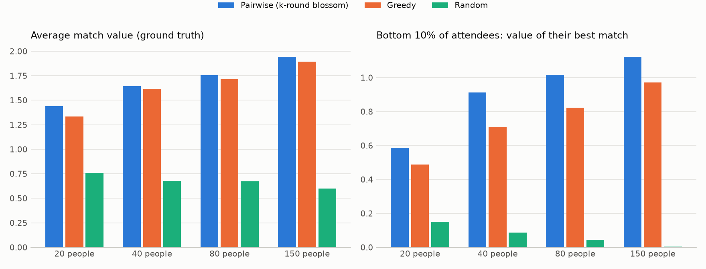

# Benchmark

> Generated by `python -m benchmarks.run`. Do not edit by hand.

Synthetic events where every attendee has hidden *wants* and *offers* topics. The matcher only sees the text they'd type, written with different wording for wanting and offering, so it has to bridge vocabulary. Each matching is then scored against the hidden truth. 10 random events per size, k = 2 matches per person.

## Solvers

| Event size | Solver | Avg match value | Real complement hit rate | Bottom 10% best match | Worst-off best match | Coverage | Time |
|---|---|---|---|---|---|---|---|
| 20 | Pairwise (k-round blossom) | 1.44 | 74% | 0.59 | 0.50 | 100% | 5 ms |
| 20 | Greedy | 1.33 | 70% | 0.49 | 0.30 | 100% | 0 ms |
| 20 | Random | 0.76 | 40% | 0.15 | 0.12 | 100% | 0 ms |
| 40 | Pairwise (k-round blossom) | 1.64 | 85% | 0.91 | 0.62 | 100% | 34 ms |
| 40 | Greedy | 1.62 | 82% | 0.71 | 0.38 | 99% | 1 ms |
| 40 | Random | 0.68 | 38% | 0.09 | 0.03 | 100% | 0 ms |
| 80 | Pairwise (k-round blossom) | 1.76 | 87% | 1.02 | 0.50 | 100% | 259 ms |
| 80 | Greedy | 1.72 | 84% | 0.82 | 0.30 | 100% | 4 ms |
| 80 | Random | 0.67 | 37% | 0.04 | 0.00 | 100% | 0 ms |
| 150 | Pairwise (k-round blossom) | 1.94 | 90% | 1.12 | 0.53 | 100% | 1861 ms |
| 150 | Greedy | 1.89 | 89% | 0.97 | 0.20 | 100% | 14 ms |
| 150 | Random | 0.60 | 32% | 0.01 | 0.00 | 100% | 0 ms |

**What this shows (80 people):**

- **vs random:** 2.6x the match value, and 87% of matches have real complementarity vs 37%.
- **vs greedy:** about the same on average (1.76 vs 1.72), but the bottom 10% of attendees get better matches (1.02 vs 0.82, 1.2x). Greedy hands the best edges to whoever is most matchable and leaves the leftovers with each other. Round-based matching spreads good matches across everyone. For an event, that's the whole point: the person who already knows the room doesn't need the tool.
- **Trade-off:** the round-based solver is O(k·n³). It's well under a second at 80 people and about 2 s at 150. Fine for club events, but past roughly 300 people it's time to switch to greedy plus local search.

**Ceiling:** running the same solver on the *true* values scores 2.29 at 80 people. Pairwise reaches 76% of that from text alone.

## Scoring ablation (80 people)

| Weights | Avg match value | Real complement hit rate | Bottom 10% best match |
|---|---|---|---|
| Default (0.55 / 0.35 / 0.10) | 1.76 | 87% | 1.02 |
| Complement only | 1.78 | 94% | 0.96 |
| Shared interests only | 1.33 | 59% | 0.50 |
| No affiliation penalty | 1.78 | 88% | 1.02 |

Scoring on complementarity alone gives the highest hit rate (94%) but the bottom 10% fall to 0.96 (default weights: 1.02). People whose needs nobody covers get nothing to talk about. Shared interests are the safety net, which is why the default blends both.

## Caveats

- Synthetic data rewards what the generator encodes. The live event test ([LIVE_TEST.md](LIVE_TEST.md)) is the real check.
- The ground-truth weighting (complement = 1, shared topic or hobby = 0.25) is a modeling choice, the same bet the scoring weights make.
- Turning off the same-affiliation penalty scores slightly *higher* here, because the generator doesn't model teammates who already know each other. The penalty exists for real events, and the live test should confirm it earns its place.
